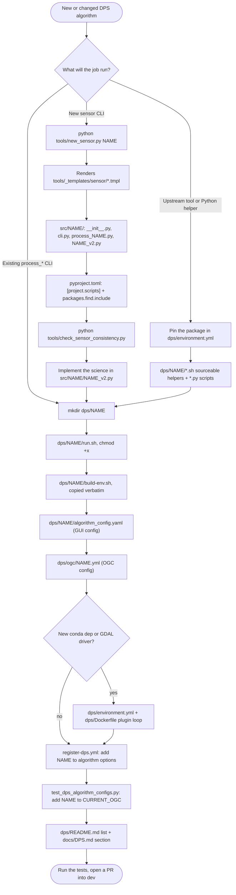
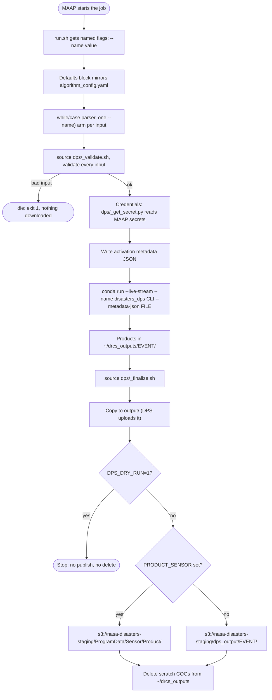
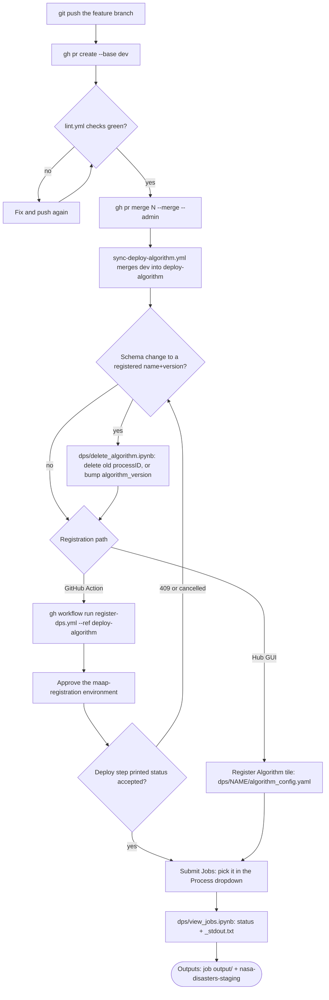
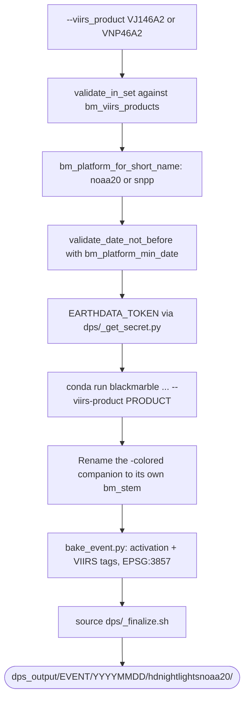

# DPS workflow: author, deploy and run a MAAP DPS algorithm

This page is the step-by-step path for contributors who add a new MAAP DPS algorithm or
change an existing one: which files to create, what `run.sh` does when a job runs, and
how a change gets from your branch to a job you can submit. Every step has the
command or file to use. For the reasons behind each rule and every known gotcha, see
the full reference, [docs/DPS.md](DPS.md); [dps/README.md](../dps/README.md) covers
the `run.sh` contract in short form.

In the diagrams, `NAME` stands for the algorithm directory name (for example `capella`
or `blackmarble`) and `EVENT` for the activation event (`YYYYMM_Hazard_Location`).

## 1. Author: the files that make an algorithm



### How to do it

1. **Branch from `dev`.** `git fetch origin && git switch -c feat/<name> origin/dev`.
   If other people are working in the same checkout, use a throwaway worktree instead:
   `git worktree add -b feat/<name> <tmpdir> origin/dev`.
2. **Optional: scaffold a new sensor CLI** (skip if the job wraps an existing
   `process_*` CLI or an external tool).
   - `python tools/new_sensor.py <name> [--bucket <vendor-bucket>] [--description "..."]`
     renders `tools/_templates/sensor/*.tmpl` into `src/<name>/`, renders the notebook
     pair, wires `process_<name> = "<name>.cli:process_<name>_cli"` into
     `[project.scripts]` and `"<name>*"` into `[tool.setuptools.packages.find].include`,
     then runs `tools/check_sensor_consistency.py` and rolls back if it fails.
   - Implement the processing in `src/<name>/<name>_v2.py`. The rendered
     `process_<name>.py` already passes `--metadata-json` to
     `convert_to_cog(metadata=...)`, which is how the activation tags reach the COG.
   - `pip install -e .`, then `process_<name> --help`. Full guide:
     [docs/ADDING_A_NEW_SENSOR.md](ADDING_A_NEW_SENSOR.md).
3. **Or wrap an upstream tool or a Python helper** (the Black Marble pattern, section 4).
   - Pin the package in the `pip:` section of `dps/environment.yml`, as a
     `git+https://...@<commit-sha>` URL if it has no release.
   - Put shell logic you want to test in **sourceable** files under `dps/<name>/`
     (functions only, nothing runs at source time), the way `dps/_validate.sh` and
     `dps/blackmarble/naming.sh` are written. Tests can then source them and call the
     functions directly.
   - Python helpers live next to `run.sh` and run inside the job env:
     `conda run --live-stream --name disasters_dps python "${basedir}/<script>.py" ...`.
   - Add the tool's `--help` to the smoke gate in `dps/Dockerfile` (as is done for
     `blackmarble --help`), so a broken install fails the image build rather than a job.
4. **Create the job directory.** `mkdir dps/<name>`, then:
   - `cp dps/capella/build-env.sh dps/<name>/`. It is path-agnostic boilerplate.
   - `cp dps/capella/run.sh dps/<name>/` (a fetch job), or `dps/landsat/run.sh` if the
     job takes a `File` input. Edit the defaults block, the `case` arms, the validators
     and the CLI arguments (skeleton in section 2).
   - `chmod +x dps/<name>/run.sh dps/<name>/build-env.sh`. A test asserts the
     executable bit. After `git add`, `git ls-files -s dps/<name>/run.sh` must show `100755`.
   - `bash -n dps/<name>/run.sh` for a syntax check.
5. **Write the GUI config** `dps/<name>/algorithm_config.yaml` (copy capella's). Set
   `algorithm_name` to `disasters-<name>-process` (must match `^[a-z0-9_-]+$`), set
   `build_command` / `run_command` to the **repo-relative** paths
   `disasters-product-algorithms/dps/<name>/build-env.sh` and `.../run.sh`, and list the
   `inputs` using **base types only** (`string, int, File, Directory, long, float,
   boolean, double`, never a `?` suffix). Each input `name` is exactly the `--flag` that
   `run.sh` parses. Never declare a credential as an input.
6. **Write the OGC config** `dps/ogc/<name>.yml` (copy `dps/ogc/capella.yml`). Use the
   **same** `algorithm_name` and the **same** input names and defaults as the GUI
   config, mark the inputs optional (`type: string?`), leave out any container field,
   and set the **absolute in-image** path
   `run_command: /app/disasters-product-algorithms/dps/<name>/run.sh`.
7. **Dependencies.** Add new conda packages to `dps/environment.yml`. A new GDAL driver
   is a separate `libgdal-*` plugin package. Add it there with no version pin, **and** add
   the driver name to the `for drv in HDF5 JP2OpenJPEG` loop in `dps/Dockerfile`.
8. **Enroll the algorithm** (CI checks both of these):
   - add `<name>` to `on.workflow_dispatch.inputs.algorithm.options` in
     `.github/workflows/register-dps.yml`;
   - add `<name>` to `CURRENT_OGC` in `tests/unit/test_dps_algorithm_configs.py`
     (`STALE_UNREGISTERED_OGC` only for a config that is deliberately not live).
   - For a `process_*` CLI, also add a `("<name>", "<name>.process_<name>")` row to
     `SENSORS` in `tests/integration/test_dps_cli_flag_contract.py`. That row checks
     that every flag `run.sh` passes is one the CLI accepts.
9. **Update the two places no test checks**: the algorithm list in `dps/README.md`
   and a `docs/DPS.md` section for the new job.
10. **Test**: `python tools/check_sensor_consistency.py` and
    `python -m pytest tests/unit/test_dps_algorithm_configs.py tests/integration/test_dps_validate.py tests/integration/test_dps_cli_flag_contract.py -q`
    (see section 5 for which environment to use).

## 2. Inside run.sh at job time



### How to do it

The skeleton below is `dps/capella/run.sh` with the comments removed. Copy it and change
only the parts specific to your algorithm.

```bash
#!/usr/bin/env -S bash --login
set -euo pipefail
basedir=$(dirname "$(readlink -f "$0")")
mkdir -p output
source "${basedir}/../_validate.sh"

DATE=""                                    # one variable per input
ACTIVATION_EVENT="YYYYMM_Hazard_Location"
SOURCE_LABEL=""
ENABLE_S3_UPLOAD="true"; STAGING_UPLOAD="true"     # locked, never job inputs
STAGING_BUCKET="nasa-disasters-staging"; STAGING_DEST_BASE="dps_output"
PRODUCT_SENSOR="<name>"                    # only if the sensor is in product_paths.py
DELETE_COG="true"

while [[ $# -gt 0 ]]; do
  case "$1" in
    --date)             DATE="$2"; shift 2;;
    --activation_event) ACTIVATION_EVENT="$2"; shift 2;;
    --source_label)     SOURCE_LABEL="$2"; shift 2;;
    *) echo "WARN: ignoring unrecognized arg: $1"; shift;;
  esac
done

require_nonempty date "${DATE}" "YYYYMMDDHHMMSS"
validate_activation_event "${ACTIVATION_EVENT}"
require_nonempty source_label "${SOURCE_LABEL}" "e.g. USGS, NASA"

OUT_HOME="${HOME}/drcs_outputs/${ACTIVATION_EVENT}"; mkdir -p "${OUT_HOME}"
META_JSON="$(mktemp -d)/activation_metadata.json"
printf '{"ACTIVATION_EVENT": "%s", "SOURCE": "%s"}\n' \
  "${ACTIVATION_EVENT}" "${SOURCE_LABEL}" > "${META_JSON}"
conda run --live-stream --name disasters_dps process_<name> \
  --date "${DATE}" --output "${OUT_HOME}" --metadata-json "${META_JSON}"

source "${basedir}/../_finalize.sh"
```

1. **Inputs arrive as named flags.** MAAP calls `run.sh --name value ...`, never
   positional `$1 $2`. A `File` input arrives as a local path. A boolean may arrive as a
   bare `--flag` or as `--flag true|false`, so parse it the way `dps/landsat/run.sh`
   does: `if [[ "${2:-}" =~ ^(true|false)$ ]]; then X="$2"; shift 2; else X="true"; shift; fi`.
2. **Defaults mirror the config.** Each default in `run.sh`, booleans especially, must
   equal the `default:` in `algorithm_config.yaml`. MAAP may leave out a flag whose value
   is the default, and a mismatched default then inverts the operator's choice.
3. **Validate before doing anything expensive.** The OGC schema has no enum, pattern or
   range, so `run.sh` is the only place to reject bad input. The functions in
   `dps/_validate.sh` are `die`, `require_nonempty`, `validate_activation_event`,
   `validate_dst_crs`, `validate_int_range`, `validate_number`, `validate_regex`,
   `validate_date_not_before`, `validate_granule`, `normalize_token`,
   `validate_in_set` and `validate_bbox <value> [min_lat_span]`. Assertions:
   `tests/integration/test_dps_validate.sh`.
4. **Secrets come from MAAP, never from job inputs.** Fetch a secret with
   `X="$(conda run --name disasters_dps python "${basedir}/../_get_secret.py" <SECRET_NAME>)" || die "..."`
   and export it for the tool. Operators store secrets once with
   `maap.secrets.add_secret("<SECRET_NAME>", "...")`.
5. **Activation metadata.** Write the JSON file and pass `--metadata-json` to a
   `process_*` CLI. A tool that writes its own COGs needs a separate bake step instead
   (`dps/blackmarble/bake_event.py`).
6. **Write products under `~/drcs_outputs/<event>/`**, then
   `source "${basedir}/../_finalize.sh"`. It copies everything into `output/` (which
   DPS uploads), publishes to `nasa-disasters-staging` with short-lived MAAP workspace
   credentials (`shared_utils.staging_upload.upload_dir_to_staging`), and deletes the
   scratch COGs. When `PRODUCT_SENSOR` is set, each product goes to its canonical
   `ProgramData/<Sensor>/<Product>/` key. Otherwise the key is
   `dps_output/<event>/<path relative to OUT_HOME>`.
7. **`DPS_DRY_RUN=1`** is an environment variable read by `_finalize.sh`. It is only a
   test hook: products are still copied to `output/`, but nothing is published and
   nothing is deleted. A DPS job never sets environment variables, so no job input can
   switch it on.

## 3. Deploy and run



### How to do it

1. **Push** the branch. If the change touches `.github/workflows/register-dps.yml`, an
   HTTPS push using the `gh` OAuth token is refused unless the token has the `workflow`
   scope. Push over SSH instead:
   `git push -u git@github.com:Disasters-Learning-Portal/disasters-product-algorithms.git feat/<name>`.
2. **Open a PR into `dev`**: `gh pr create --base dev`, then `gh pr checks <n> --watch`.
   `dev` is protected and requires one approving review, which you cannot give your own
   PR. The accepted route is `gh pr merge <n> --merge --admin`, which bypasses that
   rule, so use it only after **all** checks are green.
3. **Confirm the sync.** Every push to `dev` runs `sync-deploy-algorithm.yml`, which
   merges `dev` into the unprotected `deploy-algorithm` branch:
   `gh run list --workflow=sync-deploy-algorithm.yml --limit 1`. Never merge
   `deploy-algorithm` back into `dev`.
4. **Changing a registered process's schema?** Changes to inputs, defaults,
   `run_command` or resources do not land when you re-register the same
   `algorithm_name` + `algorithm_version`: MAAP answers `409 Duplicate process` and the
   old schema stays. First delete the old process by its numeric `processID` with
   `dps/delete_algorithm.ipynb` (kernel `disasters_dps`; only the account that deployed
   it can delete it), or register under a new `algorithm_version`.
5. **Register, by one of two paths:**
   - **Hub GUI.** Set Settings -> MAAP Settings to `maapApiUrl=https://api.maap-project.org`
     (no `/api`) and your `maapToken`, then use the Register Algorithm launcher tile
     with `dps/<name>/algorithm_config.yaml`. MAAP clones the `algorithm_version` branch
     from GitHub and runs `build-env.sh`. Unpushed code is invisible to it. Inputs are
     always required on this path.
   - **GitHub Action.** It reads `dps/ogc/<name>.yml`, builds `dps/Dockerfile`, and
     pushes the image to ghcr.io. Do a dry run first, then the real registration:
     ```bash
     gh workflow run register-dps.yml --ref deploy-algorithm \
       -f algorithm=<name> -f register_to_maap=false -f algorithm_version=dev   # dry run
     gh workflow run register-dps.yml --ref deploy-algorithm \
       -f algorithm=<name> -f register_to_maap=true -f algorithm_version=dev    # register
     gh run list --workflow=register-dps.yml --limit 1        # get <id>
     ```
     A live registration pauses until an admin approves the `maap-registration`
     environment on the run page. Then check the run with
     `gh run view <id> --json conclusion` (`gh run watch --exit-status` exits 0 even for
     a cancelled run) and with `gh run view <id> --log | grep '"status"'`. Only
     `"status": "accepted"` means the process was registered. A `409` still ends in a
     green run. **Dispatch one algorithm at a time:** `register-dps.yml` and the sync
     workflow share one concurrency group, and a second queued run silently cancels the
     run already waiting. Before the first job, the ghcr.io image package must be public.
6. **Clean up after a rename.** Changing `algorithm_name` registers a new process and
   leaves the old one runnable. Delete the old one with `dps/delete_algorithm.ipynb`.
7. **Submit a job** from the hub's Submit Jobs launcher tile. If the algorithm is not in
   the **Process** dropdown, it is not deployed, whatever "My Builds" shows.
8. **Monitor** with `dps/view_jobs.ipynb` (kernel `Python 3 (disasters_dps)`). Read the
   job's `_stdout.txt`: a `successful` badge only means `run.sh` exited 0.
9. **Results**: the job's `output/` directory, plus the published copy in
   `s3://nasa-disasters-staging/` (see section 2, step 6).

## 4. Worked example: Black Marble

`disasters-blackmarble-process` is what the pattern looks like when the job wraps an
upstream tool instead of a `process_*` CLI. It is **one** algorithm (`dps/blackmarble/`
plus `dps/ogc/blackmarble.yml`). The former NOAA-20 twin
`disasters-blackmarble-noaa-process` has been consolidated into it: the satellite is now
the `viirs_product` job input.



**What it runs.** The pipeline is NASA-IMPACT's `veda-black-marble`, installed into the
job env from the commit-SHA pin `114fa7f` in `dps/environment.yml` (a
`git+https://github.com/NASA-IMPACT/veda-black-marble@...` URL). It is not vendored
into this repo and it is not patched. The earlier `bm_georef.py` / `bm_noaa.py`
monkeypatches were deleted once upstream fixed the Landsat georeferencing and added the
product flag. `dps/Dockerfile` fails the image build if `blackmarble --help` stops
listing `--viirs-product`.

**Inputs** (`dps/blackmarble/algorithm_config.yaml`, mirrored in `dps/ogc/blackmarble.yml`):
`bbox` (`min_lon,min_lat,max_lon,max_lat`, latitude span at least 0.05 degrees),
`activation_event`, `date` (`YYYY-MM-DD`), `config` (`fast|default|high_quality`),
`osm_source` (`overpass|layercake`), `wgs84` (boolean), `earthdata_secret_name`
(default `EARTHDATA_TOKEN`) and `viirs_product`:

| `viirs_product` | Satellite | Earliest date | Output folder |
|---|---|---|---|
| `VJ146A2` (default) | NOAA-20 | 2018-01-19 | `hdnightlightsnoaa20/` |
| `VNP46A2` | Suomi-NPP: delivery ceased 2026-11-01, archive still served. Use it for dates before 2018-01-19. | 2012-01-19 | `hdnightlights/` |

**Files and their roles:**

- `dps/blackmarble/run.sh` parses the flags and validates them with `dps/_validate.sh`
  (`validate_activation_event`, `validate_bbox`, `validate_regex` for the date,
  `validate_in_set` for `viirs_product` / `config` / `osm_source`, and
  `validate_date_not_before` for the product's earliest date). It fetches the Earthdata
  token, runs upstream's `blackmarble` console script with `--bbox --date --config
  --osm-source --output-path --data-dir --log-level [--wgs84]` and
  **always passes `--viirs-product <product>` explicitly**. Upstream's default must never
  decide which satellite a job uses. Finally it renames the `-colored` companion, bakes
  the tags and sources `_finalize.sh`.
- `dps/blackmarble/platform.sh` (sourced) is the product table: `bm_viirs_products`,
  `bm_platform_for_short_name`, `bm_platform_product`, `bm_platform_min_date`,
  `bm_platform_source`.
- `dps/blackmarble/naming.sh` (sourced) holds `bm_stem`, which builds
  `<product>_<NW><SE>_<YYYY-MM-DD>_day`, e.g.
  `hdnightlightsnoaa20_37_81N122_55W37_69N122_32W_2023-06-15_day.tif`. The colored file
  uses the `<product>colored` token.
- `dps/blackmarble/bake_event.py` re-creates each COG with `ACTIVATION_EVENT` (plus
  `YEAR_MONTH` / `HAZARD` / `LOCATION`), `PROCESSOR`, `SOURCE`, `VIIRS_PRODUCT` and
  `VIIRS_PLATFORM`, reprojected to EPSG:3857. GDAL 3.10+ cannot add tags to a COG in
  place, so the file has to be rewritten.
- `dps/_get_secret.py` reads the `EARTHDATA_TOKEN` MAAP secret. If `EARTHDATA_TOKEN` is
  already exported, `run.sh` uses it and skips the MAAP lookup. A DPS job never sets
  that variable, but it is what lets tests and laptops run the job.

**Outputs.** `run.sh` sets no `PRODUCT_SENSOR`, so products publish to
`s3://nasa-disasters-staging/dps_output/<event>/<YYYYMMDD>/hdnightlightsnoaa20/`
(VJ146A2) or `.../hdnightlights/` (VNP46A2). The event lives in the S3 prefix and the
tags, not the filename.

**Run it locally** (needs the `disasters_dps` env built by
`bash dps/blackmarble/build-env.sh`, and an Earthdata token):

```bash
WORK=$(mktemp -d) && cd "$WORK"
export EARTHDATA_TOKEN='<your token>'          # skips the MAAP secret lookup
DPS_DRY_RUN=1 bash <repo>/dps/blackmarble/run.sh \
  --activation_event 202601_KyleWx_US --bbox "-122.55,37.69,-122.32,37.81" \
  --date 2023-06-15 --viirs_product VJ146A2
ls -R output/                                  # products copied, nothing published
```

## 5. Testing locally

Run the suite from the conda env that has both the geospatial stack and the editable
install (`pip install -e .`). Put that env's `bin/` first on `PATH`, because the COG
tests shell out to `rio`, and some suites run `run.sh` or the CLIs in a subprocess.
Without the install they skip rather than fail. See "How to Run" in `CLAUDE.md`.

```bash
python tools/check_sensor_consistency.py                     # pyproject wiring, <1 s
bash -n dps/<name>/run.sh                                    # syntax only
python -m pytest tests/unit tests/integration -q             # configs, validators, run.sh
DPS_DRY_RUN=1 bash dps/<name>/run.sh --activation_event 202511_Flood_TX ...   # real run, no publish
```

`tests/integration/test_blackmarble_run_sh.py` runs the real Black Marble `run.sh` with
conda stubbed and `DPS_DRY_RUN=1`. Use it as the model for a test of a new `run.sh`.

**Opt-in end-to-end tests** (`tests/e2e/`) call live NASA services and skip unless
`DPS_E2E=1` and the token are set:
`DPS_E2E=1 conda run -n disasters_dps python -m pytest tests/e2e/`. Add
`-m 'not slow'` to run only the tier that needs nothing but the token. The `slow` tier
runs whole `run.sh` pipelines and also needs ambient AWS credentials, because the
Landsat source bucket is requester-pays.
